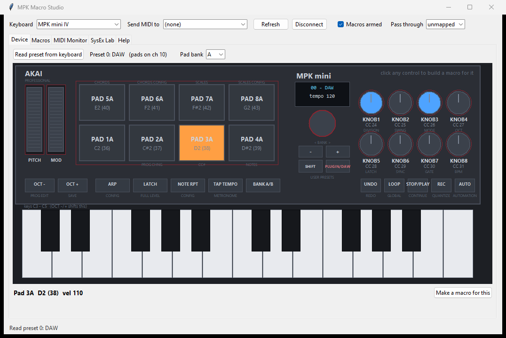

# MPK Macro Studio

[](https://github.com/jamesccupps/mpk-mini-iv-tools/actions/workflows/tests.yml)

Turns an **Akai MPK mini IV** into a macro controller for Windows, and reads
the keyboard's own presets over SysEx, using a protocol reverse-engineered for
this project and documented in [PROTOCOL.md](PROTOCOL.md).

Pure standard-library Python: no `pip install`, no dependencies.

```bash
"MPK Macro Studio.bat"
```

**Requirements:** Windows and Python 3.10+. Nothing else. It uses `winmm` and
`SendInput` through `ctypes`, with Tkinter for the UI.



*The panel lights up as you play it. Pad 3A has just been hit, and knobs 1 and
3 show their values. The pad and knob labels come from a preset dump read off
the keyboard.*

> [!WARNING]
> The SysEx tools talk to real hardware over a protocol that was
> reverse-engineered, not documented. Two things to know before you run
> anything:
>
> - **Requesting a preset appears to make the keyboard load it.** Sweeping every
>   slot leaves the unit on the last one read, with different pad assignments
>   and colors. To recover: SHIFT + PLUGIN/DAW → encoder → your preset.
> - **Never send a guessed opcode.** An early version of `re_probe.py` swept an
>   invented opcode and changed device state. Everything here now sends only
>   opcodes confirmed against hardware.
>
> Nothing here writes to the keyboard's memory, and SysEx can't damage the
> device. It can change settings you then have to put back.

Unofficial and unaffiliated with Akai Professional or inMusic. The findings
come from probing one MPK mini IV (firmware 1.41). Use at your own risk.

## Why this exists

The mini IV edits itself. Hold **SHIFT + PROG EDIT** on the keyboard and you can
change any pad's note, any knob's CC, MIDI channels, ranges and curves, then
save to one of 11 user preset slots. Akai's older "MPK mini Editor" for Windows
does **not** support this model.

What the keyboard can't do is press keys on your computer. That is what this
adds, plus a way to read its presets from the PC.

## What it does

**Device tab: a live picture of the keyboard.** Pads, knobs, wheels, keys and
the button strip are laid out like the real panel. Touch anything and it lights
up, with the note or CC it just sent shown underneath. **Read preset from
keyboard** labels each pad and knob from a preset dump. Click any control to
build a macro for it.

Highlights always come from the MIDI the keyboard actually sends. The labels
come from the dump. "Read preset" asks for slot 0, which may alias slot 1 rather
than the loaded preset, and may switch the unit to it (open questions U1/U2 in
[PROTOCOL.md](PROTOCOL.md#unknowns-register)).

Pads and keys can share note numbers, so the view uses the pad MIDI channel from
the preset to tell them apart (channel 10 on the factory presets). The keyboard
drawing re-bases itself when you use OCT − / OCT +.

**Macros.** Any pad, key or knob can fire:

| Action | What it does |
|---|---|
| `keys` | A keyboard shortcut in the focused app (`ctrl+shift+s`) |
| `text` | Types a block of text |
| `run` | Launches a program or file |
| `wait` | Pauses between steps |
| `chord` | Plays a chord out of a MIDI port, with optional strum |
| `cc` | Sends a CC. Set the value to `passthru` for **macro knobs** |
| `note` / `program` | A single note, or a program change |

Chain several actions into one macro and they run in order.

**Profiles** follow the focused app. Put `Ableton Live 12 Suite.exe` in the
auto-switch box and that profile is live *only* while Live has focus. Alt-tab
to a browser and its shortcuts stop. A profile with the box left blank is
global: the one you last selected applies everywhere else. The status bar shows
which profile is live.

**MIDI Monitor** shows exactly what the keyboard sends, so you never have to
guess a pad number.

**SysEx Lab** sends raw SysEx and decodes the replies. This is where the
protocol was worked out.

## Setup

1. Run `MPK Macro Studio.bat`. It finds the keyboard and connects. Connecting
   sends nothing to the keyboard.
2. On the **Device** tab, press the pad or turn the knob you want to use. It
   lights up, so you know you've got the right one.
3. Click it, add an action, and Save.
4. Focus your DAW and hit the pad.

Both included profiles ship with every macro **disabled**, so nothing surprises
you. Tick "Enable / disable" on the ones you want.

### Worked example: a one-button looper for Ableton

`profiles/Ableton Looper.json` turns the top four keys into Live commands
(Duplicate, Quantize, Undo, New MIDI track), so a whole layered take can be
built without touching the computer.

Capture MIDI is deliberately left out, because Live 12 removed its shortcut.
See [docs/ableton.md](docs/ableton.md#capture-midi) for MIDI-mapping it instead.

It uses the **top keys rather than pads** on purpose. A macro on a pad still
plays its drum sound, because the DAW hears the keyboard directly; "swallow"
only governs this app's own passthrough. Notes above 51 fall outside a Drum
Rack's sample range, so they stay silent while still firing the macro. If you
want macro *pads* that make no sound, route the DAW through loopMIDI instead.

The four macros ship disabled. Pick **Ableton Looper** on the Macros tab and
enable them. The profile auto-activates when any Live 12 edition (Lite, Intro,
Standard or Suite) has focus. For other apps, focus the app and use **Use
focused app** to fill in its exact `.exe` name.

### Playing notes *and* running macros at once

A macro that swallows its message stops it reaching the DAW, and `chord`/`cc`
actions need somewhere to send notes. A virtual MIDI cable solves both:

1. Install **loopMIDI** (free, Tobias Erichsen) and create a port.
2. Set **Send MIDI to** to that port.
3. Point your DAW at the loopMIDI port instead of the MPK directly.

Without it, macros still work: keystrokes need no MIDI routing at all.

### Sharing profiles

A profile is a JSON file in `profiles/`. A `run` action launches whatever it
names, so treat a profile from someone else like a script, and read it before
you enable it.

## Ableton Live

Port setup for Live's bundled `MPK_mini_IV` script, DAW mode that drops back to
MIDI, and latency and silent-output fixes are in
[docs/ableton.md](docs/ableton.md).

## The protocol

[PROTOCOL.md](PROTOCOL.md) is the reference. It covers the identity reply,
product ID `0x5D`, the Akai message envelope, the opcodes seen so far, and the
276-byte preset layout down to the pad and knob records. Each finding is tagged
by how it was established: captured bytes, live observation, both, or
inference. An unknowns register lists what is still open, each item with the
test that would settle it. If you have one of these keyboards, that list is
the place to start.

### Tools

```bash
py -3 dump_presets.py          # slot 0, in plain English
py -3 dump_presets.py --all    # every slot (changes what is loaded)
py -3 dump_presets.py --json   # machine readable
py -3 dump_presets.py --raw    # hex
py -3 device_info.py           # firmware version and serial number
py -3 re_probe.py              # identity + dump requests on every port
py -3 port_scout.py            # which USB MIDI port carries what
py -3 button_map.py            # guided: what each button and the encoder send
py -3 audio_test.py --list     # unrelated to MIDI; identifies audio outputs
```

None of these writes to the keyboard's memory. The ones that request presets
(`dump_presets.py`, `re_probe.py`) may change which preset is *loaded*.

`button_map.py` walks you through the controls one at a time and writes
`button_map.json`. The preset dump covers the pads and knobs but not the buttons,
so what ARP, LATCH, NOTE REPEAT, TAP TEMPO, UNDO, LOOP, transport and the encoder
send is still unrecorded (U16). Run it once in DAW mode and once in MIDI mode:
the DAW script swallows some buttons, and which ones is worth knowing. `--only
LATCH ARP` redoes single controls.

## Layout

```
main.py                 launcher
MPK Macro Studio.bat    double-click this
PROTOCOL.md             the SysEx protocol, with evidence and open questions
docs/ableton.md         Live setup, latency, audio troubleshooting
dump_presets.py         read presets from the keyboard
device_info.py          firmware version and serial
re_probe.py             SysEx reconnaissance
port_scout.py           identify the USB MIDI ports
button_map.py           guided button/encoder mapper
audio_test.py           tone through each Windows audio output
profiles/*.json         your macros, one file per profile
settings.json           last-used ports (not committed)
mpk-macro-studio.log    runtime log (not committed)
mpkmacro/
  winmidi.py            MIDI in/out + SysEx via winmm
  winput.py             SendInput keystrokes, foreground app
  engine.py             profiles, matching and action execution
  gui.py                Tkinter UI
  device_view.py        the live panel drawing
  mpk_preset.py         preset format and message decoding
  applog.py             log file setup
tests/                  no hardware required
```

## Tests

```bash
py -3 -m unittest discover -s tests -t .
```

No keyboard is needed, and CI runs the suite on Windows. The protocol tests use
`tests/fixtures.py`, which holds real SysEx captured from hardware: a 284-byte
preset dump, the identity reply, both pad-mode messages and both status
messages. So the parser is checked against what the device actually sends,
not against examples written to match the parser. The serial number in the
identity fixture is zeroed.

## Notes

- Windows only: it uses `winmm` and `SendInput` directly.
- Keystrokes go to whatever window has focus, exactly as if typed. Windows
  blocks them from reaching apps running as administrator unless this app is
  elevated too.
- If something goes wrong, `mpk-macro-studio.log` next to `main.py` has the
  details. The launcher uses `pythonw`, so there is no console.
- MIDI callbacks do the minimum on the system thread and hand off to a worker,
  which is why SysEx dumps arrive intact.

## License

MIT. See [LICENSE](LICENSE).
